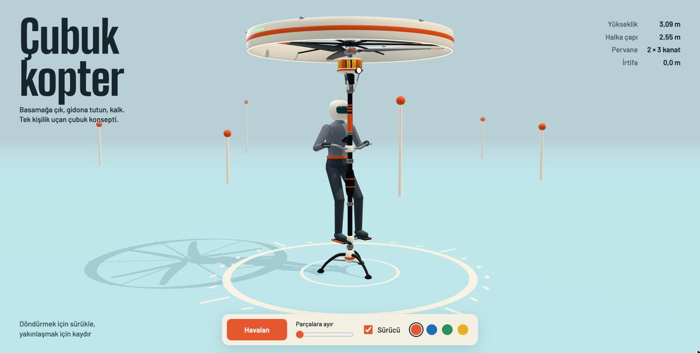

# Çubukkopter

Çubuğuna tutunularak uçulan tek kişilik kopterin özgün 3D konsept tasarımı.

**[3D modeli tarayıcıda aç](https://borabasol.github.io/cubukkopter/)**



Sayfada modeli döndürebilir, havalanıp ok tuşlarıyla uçabilir, parçalara ayırabilir, rengini değiştirebilir ve sürücüyü gizleyebilirsin. Telefonda da çalışır.

## Tasarım

| Bölüm | Çözüm |
|---|---|
| Pervane | Ters yönde dönen iki adet 3 kanatlı pervane; dönme torkları birbirini dengeler, kuyruk pervanesi gerekmez |
| Koruma halkası | 2,55 m çap, altında ışık şeridi, yanlarda kırmızı ve yeşil seyir ışığı |
| Güç kafası | Çevresinde 12 batarya hücresi, önünde far |
| Mafsal | Körük ve üç itici kol; kafayı yatırarak yön verir |
| Direk | Karbon boru, uyluk desteği, gidon, gösterge |
| Basamak ve ayak | Kaymaz iki basamak, sönümleyicili üç bacak |

Toplam yükseklik 3,09 m. Sürücü mankeni ölçek içindir.

## Dosyalar

- [model/cubukkopter.glb](model/cubukkopter.glb): renkli model, parçaları ayrı düğümlerde. Blender, Unity ve Unreal ile açılır.
- [model/cubukkopter.stl](model/cubukkopter.stl): milimetre ölçekli gövde, GitHub üzerinde döndürülerek incelenebilir. Baskı için hazırlanmadı.
- [kaynak/build.py](kaynak/build.py): modeli üreten Blender betiği.

Yeniden üretmek için:

```sh
blender -b --python kaynak/build.py
```

Yerelde açmak için klasörde `python3 -m http.server` çalıştırıp `http://localhost:8000` adresine git.

## Not

Bu bir görsel konsepttir. Yapısal, aerodinamik ve güvenlik hesabı yapılmadı; gerçek bir hava aracının planı olarak kullanma.
